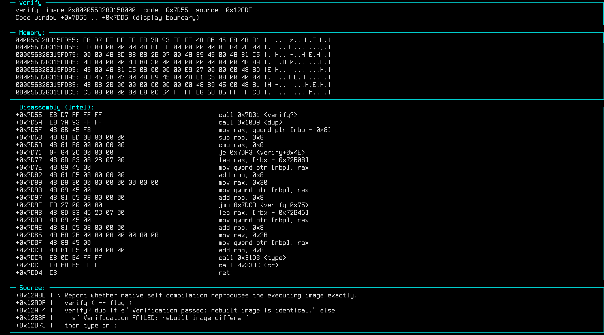
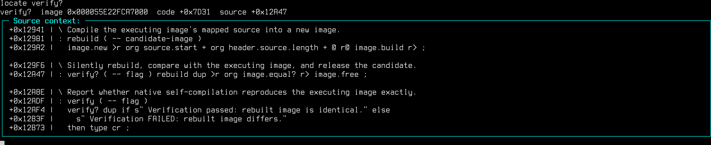
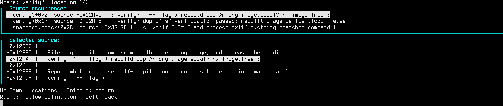
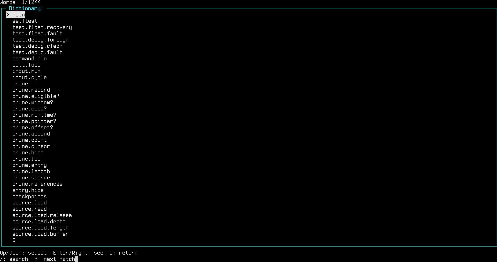

humane computing forth
----------------------

humane computing forth is a proof of concept forth implementation whose goals
are aligned with the https://humanecomputing.org manifesto.

* pausable
* binary mapped one-to-one with source
* causal end to end
* bounded for one mind
* explicit state
* replayable and resumable
* alive

h.c.forth is written from scratch in forth and initially bootstrapped from
SwiftForth using a small cross compiling shim.f which generated the initial
binary.  Unlike most programming environment, h.c.forth embeds it's full 
source in the executable itself, and by verifies it can reproduce it's own
build from it's own source.  You can check for yourself by running:

    ./forth verify

The above command tells h.c.forth to run the word verify.  You can see the
implementation of this word using:

    ./forth see verify 

This will generate the following text:

The word "see" dumps a full machine code & source trace displaying where the code is in memory, 
dumps the content of memory for the machine code segment, disassembles the machine code to 
Intel assembler dereferencing for words, and displaying the source code that generated that code. 

You can find the source code to a word incontext using "locate" for example "locate verify?" will
display:

To find all the locations a word is refrenced in the system you can use the command "where" to
find them.  For example "where verify?" will display the following interface:

To see all the words in the system you can use the "words" browser to navigate.  It also supports search!

