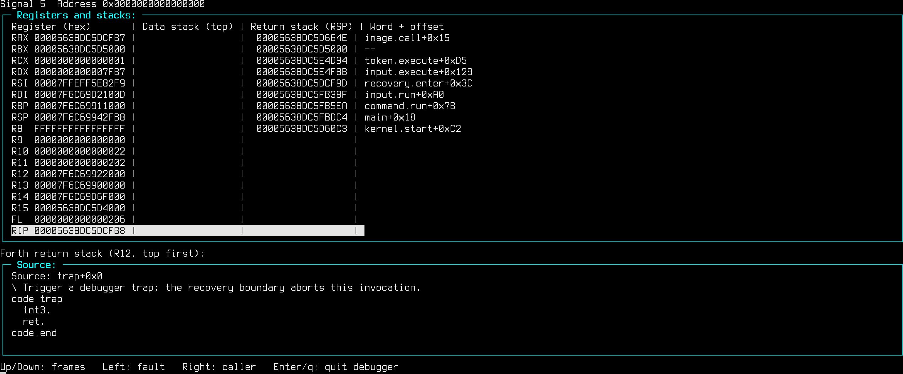

humane computing forth
----------------------

humane computing forth is a proof of concept forth implementation whose goals
are aligned with the https://humanecomputing.org manifesto.

* pausable
* binary mapped one-to-one with source
* causal end to end
* bounded for one mind
* explicit state
* replayable and resumable
* alive

h.c.forth is written from scratch in forth and initially bootstrapped from
SwiftForth using a small cross compiling shim.f which generated the initial
binary.  Unlike most programming environments, h.c.forth embeds its full
source in the executable itself, and verifies it can reproduce its own build
from its own source.

## Getting Started

### Prerequisites

* Linux x86-64
* glibc (`libc.so.6`, `libdl.so.2`) at runtime
* A native seed executable at `selfhost/seed/forth` (retained in the repo)
* GNU make, and a C compiler only for the FFI test library (`make test`)

### Build

```sh
make
```

The seed binary at `selfhost/seed/forth` reads `forth.f`, compiles a first
candidate, then that candidate recompiles itself and compares both outputs
byte-for-byte.  The final `./forth` executable is installed only after the
triple self-compilation check passes.  Build artifacts land in `selfhost/build/`.

Other make targets:

```sh
make verify      # run the built-in self-test suite
make test        # build + regression tests + source-load checks
make seed        # promote the current ./forth as the new retained seed
make clean       # remove build outputs (the seed is never removed)
```

### Run

Pass Forth words directly on the command line:

```sh
./forth 1 2 + .              # prints 3
./forth '9 dup * . cr'       # prints 81
./forth verify               # self-compilation check; prints pass/fail
```

With no arguments, `./forth` opens an interactive line loop.  History is saved
to `$HOME/.forth`.  On a terminal, Up/Down recalls previous lines, Ctrl-U
clears the current line, and Ctrl-D exits.

```sh
$ ./forth
: sq dup * ;
9 sq .                       \ prints 81
bye
```

### Load a source file

```sh
./forth build.file forth.f /tmp/out    # compile forth.f into /tmp/out/
source.load hello.f                    # inside the REPL: append and compile
```

### Snapshots

Save and restore the running system:

```forth
snapshot Initial working version
snapshots                              \ browse revisions
restore native.snapshots/00000000
undo
```

### Introspection commands

`see`, `locate`, `where`, and `words` all work on the live dictionary without
any external source file.

**`see name`** — disassembles a word: hex dump, Intel x86-64 disassembly, and
the original source text.

    ./forth see verify


**`locate name`** — shows the definition in context with its neighbouring
source entries.

    ./forth locate verify?


**`where name`** — lists every occurrence of a word across the entire embedded
source, with the containing definition and source offset for each hit.

    ./forth where verify?


**`words`** — a full-screen browser of all dictionary entries.  Type `/text`
then Enter to search; `n` finds the next match; Enter or Right opens `see`.


### Debugger

`debug.on` installs a post-fault hook that prints registers, the data,
floating-point and return stacks, and the source window around the faulting
instruction.  On a terminal, arrow keys navigate the native call stack.

    ./forth debug.on trap



`debug.off` clears the hook.
